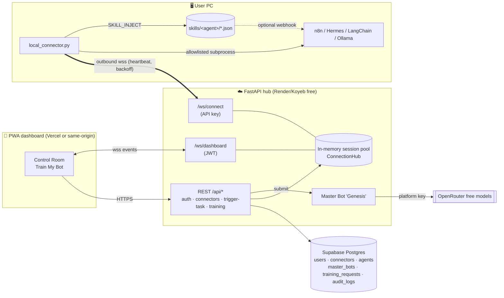

# 🛰️ BridgeBot AI — Dual-Service SaaS for AI Agents (100% free stack)

**Service 1 — Cloud-to-Local Bridge.** Your heavy agents (n8n, Hermes, LangChain, Ollama, llama.cpp…) stay on your own PC. A tiny Python daemon (`local_connector.py`) opens an *outbound* secure WebSocket to the cloud hub, so a mobile PWA can send tasks and watch live stdout/stderr from anywhere — no port-forwarding, no static IP.

**Service 2 — On-Demand Training & Skill Sync.** You describe your niche; the platform's Master Bot ("Genesis") compiles a JSON **Skill Payload** (system prompt, prompt templates, tool schemas, memory config, guardrails, eval cases) using **platform** tokens via OpenRouter free models. You preview and approve; the payload is injected over the bridge into your local agent (`SKILL_INJECT` → saved to `skills/<agent>/<skill>.json` → `SKILL_ACK`).

| Layer | Tech | Free host |
|---|---|---|
| Database | PostgreSQL (`db/schema.sql`) / SQLite fallback | Supabase Free |
| Cloud hub | FastAPI + WebSockets + async SQLAlchemy, JWT + bcrypt | Render Free / Koyeb Free |
| Master Bot LLM | OpenRouter `openrouter/free` + `:free` fallbacks; deterministic template fallback | OpenRouter free models |
| Dashboard | Next.js 15 (App Router, TS, Tailwind v4), PWA (manifest + service worker), static export | Vercel Hobby — or served by the hub itself |
| Local daemon | Python asyncio + `websockets` | your PC |

---

## Architecture



### Wire protocol (JSON over WebSocket)

| Direction | Type | Fields |
|---|---|---|
| cloud → connector | `WELCOME` | `connector_id, machine_name, heartbeat_timeout_s` |
| connector → cloud | `HELLO` | `machine, version, platform, agents[{name,type}], allowed_commands` |
| connector ↔ cloud | `PING` / `PONG` | `ts` (every 20 s; server drops silent sockets after 90 s) |
| cloud → connector | `TASK` | `task_id, command (str or argv[]), timeout_s, cwd` |
| connector → cloud | `TASK_STARTED` · `LOG` · `TASK_RESULT` | `task_id, stream=stdout/stderr, line` · `exit_code, duration_ms, error, stdout_tail` |
| cloud → connector | `CANCEL` | `task_id` |
| cloud → connector | `SKILL_INJECT` | `request_id, agent_name, payload{skill_id,…}` |
| connector → cloud | `SKILL_ACK` | `request_id, agent_name, skill_id, path, ok, error?` |
| cloud → dashboard | `SNAPSHOT`, `CONNECTOR_STATUS`, `TASK_DISPATCHED`, `TRAINING_STATUS`, `SKILL_INJECT_SENT` + every connector event above | |

### Training lifecycle
`PENDING → TRAINING → READY → (user approves) → APPROVED` (or `FAILED`). Cost = LLM `usage.total_tokens` (min `MIN_TRAINING_COST`), deducted from the user's `token_balance` (new accounts get `SIGNUP_TOKEN_GRANT`).

---

## Repository layout

```
bridgebot/
├── db/schema.sql                  # canonical Postgres/Supabase DDL (UUID PKs, FKs, CHECKs, indexes, RLS)
├── backend/
│   ├── server.py                  # FastAPI app: lifespan, CORS, routers, static PWA mount
│   ├── app/config.py              # pydantic-settings (.env)
│   ├── app/database.py            # async engine (asyncpg | aiosqlite), init + seed
│   ├── app/models.py              # ORM models (portable UUID/JSONB)
│   ├── app/security.py            # bcrypt, JWT, API-key generation + SHA-256 hashing
│   ├── app/deps.py · schemas.py   # auth dependency, pydantic I/O models
│   ├── app/hub.py                 # WebSocket session pool + fan-out
│   ├── app/master_bot.py          # OpenRouter free-model compiler + template fallback
│   ├── app/audit.py               # audit_logs writer
│   ├── app/routers/{auth,connectors,tasks,training,ws}.py
│   ├── requirements.txt · .env.example · Dockerfile (API-only)
├── connector/
│   ├── local_connector.py         # the local daemon
│   ├── connector_config.example.json · requirements.txt
├── frontend/                      # Next.js PWA (src/app/{login,dashboard,train}, src/lib, src/components, public/sw.js)
│   └── vercel.json · .env.example
├── tests/e2e_test.py              # full end-to-end test (real server + real daemon + dashboard socket)
├── tests/test_master_bot.py       # OpenRouter path (mocked HTTP) + fallback
├── Dockerfile · render.yaml · .dockerignore
└── docs/                          # screenshots + verification log
```

---

## Run locally (zero cost, ~3 minutes)

Requirements: Python 3.10+, Node 18.18+.

```bash
# 1) Backend (SQLite + template Master Bot by default)
cd backend
python -m venv .venv && source .venv/bin/activate      # Windows: .venv\Scripts\activate
pip install -r requirements.txt
cp .env.example .env            # optionally add OPENROUTER_API_KEY
uvicorn server:app --reload --port 8000                # API docs: http://localhost:8000/docs

# 2) Frontend (dev mode)
cd ../frontend
npm install
cp .env.example .env.local      # NEXT_PUBLIC_API_URL=http://localhost:8000
npm run dev                     # http://localhost:3000
#   …or build the static PWA and let the backend serve it on :8000:
#   rm -f .env.local && npm run build   (backend auto-mounts frontend/out)

# 3) Connector — on the PC that runs your agents
cd ../connector
pip install websockets
#   Register, click "Add machine" in the dashboard, copy the key (shown ONCE), then:
python local_connector.py --server http://localhost:8000 --api-key bbk_xxx --machine-name home-pc
#   or: cp connector_config.example.json connector_config.json && edit && python local_connector.py

# 4) Tests
cd .. && python tests/e2e_test.py && python tests/test_master_bot.py
#   Postgres:  E2E_DATABASE_URL=postgresql://postgres:pw@localhost:5432/bridgebot python tests/e2e_test.py
#   Deployed:  BASE_URL=https://your-app.onrender.com python tests/e2e_test.py --external
```

### Connector safety
* Commands run via `create_subprocess_exec` — **never a shell** — so `;`, `|`, `&&` can't chain commands.
* Only executables in `allowed_commands` run. Interpreters (`python`, `node`, `bash`, `powershell`) are **excluded by default** because they allow arbitrary code — add them only if you accept that. `--allow-any-command` disables the allowlist (not recommended).
* Per-task timeout, max concurrent tasks, output line/size caps, `CANCEL` support.
* Skill files: path-traversal-safe names, atomic writes, `active_skills.json` manifest; optional `skill_hook_url` to POST each new skill to a local agent (e.g. an n8n Webhook node) so it can hot-reload.
* The connector only makes **outbound** connections; the API key is sent in the `Authorization` header and stored server-side only as a SHA-256 hash.

### Wiring skills into your agent
Point your agent at `skills/<agent>/active_skills.json` and load each skill file: use `system_prompt` as the system message, register `tools[]` (OpenAI function-calling JSON schema — works with LangChain `StructuredTool`, Ollama tools, n8n AI Agent node), seed memory with `memory.seed_facts`, and use `evaluation[]` as smoke tests.

---

## 🆓 Free deployment guide (checked Oct 2026)

> Free tiers change — re-check the linked pages before relying on them.

### Option A (simplest): one Render service = API + WebSockets + PWA
1. Push this folder to a GitHub repo.
2. **Database — Supabase Free** ([pricing](https://supabase.com/pricing)): 500 MB DB, 2 active projects; *paused after 7 days of inactivity* (a connected daemon's heartbeats keep the DB busy; restore from the dashboard if paused).
   * New project → SQL Editor → paste `db/schema.sql` → Run.
   * Project → **Connect** → copy the **Session pooler** URI (port 5432, IPv4-compatible; the direct `db.<ref>.supabase.co` host is IPv6-only and fails on Render/Koyeb).
3. **Backend — Render Free** ([docs](https://render.com/docs/free)): New → **Blueprint** → pick the repo (uses `render.yaml` + root `Dockerfile`). Set `DATABASE_URL` (Supabase pooler URI) and optionally `OPENROUTER_API_KEY`. `JWT_SECRET` is auto-generated.
   * Free services spin down after 15 min with **no inbound HTTP *and* no inbound WebSocket messages** (WS messages count since Feb 2026), so a running connector (20 s heartbeat) keeps it awake; cold start ≈ 1 min — the connector's backoff loop simply reconnects.
   * 750 free instance-hours/month (enough for one always-on service). Filesystem is ephemeral → **don't rely on the SQLite fallback in production**.
4. Open `https://<service>.onrender.com` → register → Add machine → run on your PC:
   `python local_connector.py --server https://<service>.onrender.com --api-key bbk_…` (auto-converted to `wss://…/ws/connect`).

### Option B: frontend on Vercel, API on Render/Koyeb
* **Vercel Hobby** (free, non-commercial): import repo → Root Directory `frontend` → env `NEXT_PUBLIC_API_URL=https://<api-host>` → Deploy. Then set backend `CORS_ORIGINS=https://<project>.vercel.app`.
* **Koyeb Free** ([docs](https://www.koyeb.com/docs/reference/instances)) instead of Render: 1 free web service (512 MB, 0.1 vCPU, Frankfurt/Washington), WebSockets supported, scales to zero after 1 h without traffic/held connections. Create Web Service → GitHub → Dockerfile builder (root `Dockerfile`, or `backend/Dockerfile` for API-only) → port 8000 → health check HTTP `/healthz` → env vars as above.

### LLM — OpenRouter free models ([limits](https://openrouter.ai/docs/api_reference/limits))
Create a key at openrouter.ai/keys (no card). `:free` models cost $0; limits are **20 req/min and 50 req/day** (1,000/day after a one-time $10 credit purchase). Default model is the `openrouter/free` router, with fallbacks in `OPENROUTER_FALLBACK_MODELS` (models present in the free list on 17 Oct 2026: `google/gemma-4-31b-it:free`, `nvidia/nemotron-3-super-120b-a12b:free`, …). Check the current list: `curl -s https://openrouter.ai/api/v1/models | grep ':free'`. If the key is missing or every model fails, the deterministic template compiler still produces a valid payload.

### Exposing a local backend without any account (testing only)
* `cloudflared tunnel --url http://localhost:8000` → random `https://*.trycloudflare.com` URL, WebSockets supported, no Cloudflare account. Needs outbound TCP/UDP 7844.
* `ssh -R 80:localhost:8000 nokey@localhost.run` → random HTTPS URL, no signup (needs outbound SSH).
These are ephemeral (URL changes each run) — fine for demos, not production.

---

## Production notes / limitations
* **Single process**: the live session pool is in memory, so run 1 worker/instance (free tiers do anyway). For horizontal scale, swap `ConnectionHub` for Redis pub/sub.
* Token accounting is internal credits; no payment gateway is included.
* Dashboard JWT is stored in `localStorage` and sent to `/ws/dashboard` as a query param (browsers can't set WS headers). Use HTTPS only; consider short JWT expiry.
* Rate limiting / email verification / password reset are not implemented.
* Free hosts sleep: the first request after idle can take ~1 min on Render.
