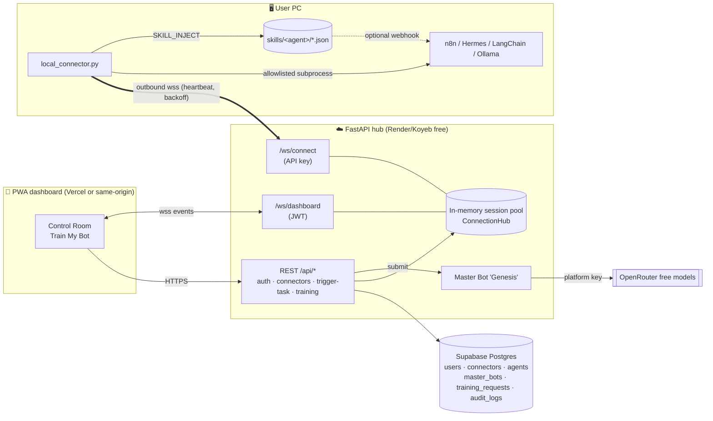

# 🛰️ BridgeBot AI — Dual-Service SaaS for AI Agents (100% free stack)

**Service 1 — Cloud-to-Local Bridge.** Your heavy agents (n8n, Hermes, LangChain, Ollama, llama.cpp…) stay on your own PC. A tiny Python daemon (`local_connector.py`) opens an *outbound* secure WebSocket to the cloud hub, so a mobile PWA can send tasks and watch live stdout/stderr from anywhere — no port-forwarding, no static IP.

**Live:** https://bridgebot-ai.onrender.com (Render free, auto-deploys from `main`).

**Universal Bot Bridge.** Any bot — Hermes Agent, OpenClaw, n8n, LangChain, any HTTP/CLI bot, or an external cloud bot such as Grok Bot — links via the local connector *or* the generic **Bot API** (bot token → long-poll / WebSocket / webhook → reply over REST). A one-file Python SDK doubles as a no-code adapter.

**Master Bot Marketplace.** The owner (admin) publishes Master Bots (skill payload + persona + tools + follow-up test). Subscribers add their bot to a master's messenger group or click **“Make my bot a master”**; the master then welcomes it, injects the skill (`SKILL_INJECT` for connector bots, Bot-API/webhook update for external bots), runs a follow-up test and certifies it — fully automatic, gated by plan.

**SaaS layer.** Marketing site (landing, pricing, docs), Free/Pro/Business subscriptions with enforced limits, PayPal.Me + WhatsApp manual payments approved by the admin (Stripe/Paddle pluggable), HMAC-signed outbound webhooks with retries, inbound task webhooks, personal API keys, user dashboard and Master Admin dashboard.

**Service 2 — On-Demand Training & Skill Sync.** You describe your niche; the platform's Master Bot ("Genesis") compiles a JSON **Skill Payload** (system prompt, prompt templates, tool schemas, memory config, guardrails, eval cases) using **platform** tokens via OpenRouter free models. You preview and approve; the payload is injected over the bridge into your local agent (`SKILL_INJECT` → saved to `skills/<agent>/<skill>.json` → `SKILL_ACK`).

| Layer | Tech | Free host |
|---|---|---|
| Database | PostgreSQL (`db/schema.sql`) / SQLite fallback | Supabase Free |
| Cloud hub | FastAPI + WebSockets + async SQLAlchemy, JWT + bcrypt | Render Free / Koyeb Free |
| Master Bot LLM | OpenRouter `openrouter/free` + `:free` fallbacks; deterministic template fallback | OpenRouter free models |
| Dashboard | Next.js 15 (App Router, TS, Tailwind v4), PWA (manifest + service worker), static export | Vercel Hobby — or served by the hub itself |
| Local daemon | Python asyncio + `websockets` | your PC |

---

## Architecture



### Wire protocol (JSON over WebSocket)

| Direction | Type | Fields |
|---|---|---|
| cloud → connector | `WELCOME` | `connector_id, machine_name, heartbeat_timeout_s` |
| connector → cloud | `HELLO` | `machine, version, platform, agents[{name,type}], allowed_commands` |
| connector ↔ cloud | `PING` / `PONG` | `ts` (every 20 s; server drops silent sockets after 90 s) |
| cloud → connector | `TASK` | `task_id, command (str or argv[]), timeout_s, cwd` |
| connector → cloud | `TASK_STARTED` · `LOG` · `TASK_RESULT` | `task_id, stream=stdout/stderr, line` · `exit_code, duration_ms, error, stdout_tail` |
| cloud → connector | `CANCEL` | `task_id` |
| cloud → connector | `SKILL_INJECT` | `request_id, agent_name, payload{skill_id,…}` |
| connector → cloud | `SKILL_ACK` | `request_id, agent_name, skill_id, path, ok, error?` |
| cloud → dashboard | `SNAPSHOT`, `CONNECTOR_STATUS`, `TASK_DISPATCHED`, `TRAINING_STATUS`, `SKILL_INJECT_SENT` + every connector event above | |

### Training lifecycle
`PENDING → TRAINING → READY → (user approves) → APPROVED` (or `FAILED`). Cost = LLM `usage.total_tokens` (min `MIN_TRAINING_COST`), deducted from the user's `token_balance` (new accounts get `SIGNUP_TOKEN_GRANT`).

---

## SaaS features

### Plans & limits (`backend/app/billing/plans.py`, upserted into `plans` on every start)
| Plan | Price | Tokens / month | Machines | Tasks / day | Webhooks | API keys | Linked bots | Inbound webhook | Marketplace |
|---|---|---|---|---|---|---|---|---|---|
| Free | $0 | 5,000 | 1 | 50 | 1 | 1 | 1 | – | Free masters |
| Pro | $19 | 100,000 | 5 | 1,000 | 10 | 5 | 10 | ✓ | Free + Pro masters |
| Business | $79 | 500,000 | 25 | unlimited | 50 | 20 | 50 | ✓ | all masters |

New accounts get **Free** automatically. Hitting a limit returns **402** (daily task quota: **429**). The Free period renews every 30 days (tokens reset); an expired paid period drops to Free with `PAST_DUE`.

### Payments (manual today, gateway-ready)
1. Pricing / Subscription page → **Pay with PayPal** → `https://paypal.me/BunnyOnMoney/<price>USD` (Abdul Rehman Chohan), or **Contact on WhatsApp** (+966 56 700 9846, prefilled with plan + email).
2. The user submits an **upgrade request** with the PayPal transaction ID / PayPal email (`payment_method=paypal` requires it).
3. Admin → **Upgrades** → Approve → plan activated for N months, payment recorded in the revenue ledger (MRR / revenue stats).
4. Stripe/Paddle: implement `create_checkout()` + `parse_webhook()` in `billing/providers.py`, set `PAYMENT_PROVIDER=stripe|paddle` + keys; `/api/billing/checkout` and `/api/billing/webhook/{provider}` already route there and activate through the same `apply_plan()` / `record_payment()`.

### Admin
* **Only `ADMIN_EMAIL` (default `Abaudii12@gmail.com`, case-insensitive) is admin** — role is re-derived on every request; there is no “first user becomes admin”. Register/log in with that email → **🛡️ Master Admin** appears in the nav (`/admin/`).
* Optional `ADMIN_PASSWORD` env var auto-creates that account at startup.
* Admin can: see stats (users by plan/status, MRR, revenue, online machines, tasks, tokens, deliveries), approve/reject upgrades, change plan / months, suspend / ban / reactivate (kicks live sessions), adjust tokens, view all connectors, payments and audit logs, and **publish / edit / unpublish Master Bots** (or publish any trained payload in one click).

### Universal Bot API (`backend/app/routers/bots.py`, docs: `/docs/bots/`)
| Side | Endpoint | Purpose |
|---|---|---|
| owner | `POST /api/bots` | link a bot `{name, framework, delivery: poll/websocket/webhook/connector, webhook_url?, connector_id?, agent_name?}` → `{bot, token (bbt_…, once), secret (whsec_…)}` |
| owner | `GET/PATCH/DELETE /api/bots/{id}`, `POST /api/bots/{id}/rotate-token` | manage |
| owner | `POST /api/bots/{id}/messages`, `GET /api/bots/{id}/messages` | chat with the bot / conversation |
| bot | `GET /api/bot/me` | identity (auth `Authorization: Bot bbt_…`) |
| bot | `GET /api/bot/updates?offset=&timeout=` | Telegram-style long polling |
| bot | `POST /api/bot/messages {text, reply_to?, chat?, group_id?}` | reply / message owner / post in a group |
| bot | `POST /api/bot/ack {update_id, ok, error?}` | ACK (confirms `skill_inject` installs) |
| bot | `GET /api/bot/skills` | re-sync installed master skills |
| bot | `WS /ws/bot?token=bbt_…` | realtime: `READY`, `UPDATE` ⇄ `MESSAGE`, `ACK`, `PING` |

Webhook delivery POSTs `{event:"bot.update", bot_id, update}` signed with `X-BridgeBot-Signature` (bot secret); a JSON `{"text": …}` response is taken as the reply (n8n “Respond to Webhook”).

**SDK / adapters** — `connector/bridgebot_sdk.py` (stdlib only, downloadable at `/downloads/bridgebot_sdk.py`):
```bash
python bridgebot_sdk.py --token bbt_… --exec "hermes chat --oneshot -Q -q {text}" --skills-dir ~/.hermes/skills --skill-format skillmd   # Hermes Agent
python bridgebot_sdk.py --token bbt_… --exec "openclaw agent --message {text}" --skills-dir ~/.openclaw/workspace/skills --skill-format skillmd  # OpenClaw
python bridgebot_sdk.py --token bbt_… --http http://localhost:5678/webhook/my-bot     # n8n / any local HTTP bot
```
Commands run without a shell (`{text}` is one argv element); skills are written as JSON or `SKILL.md` and ACKed automatically.

### Master Bot Marketplace (`backend/app/botnet.py`, `routers/marketplace.py`, docs: `/docs/marketplace/`)
* Public catalogue `GET /api/marketplace`; three starter masters are seeded into an empty table (Customer Support Master — Free, n8n Automation Architect — Pro, Sales Closer Elite — Business).
* `POST /api/marketplace/{id|slug}/join {bot_id}` or `/make-master` (also clones the persona) → automation: **welcome → skill injection → ACK → follow-up test → GRADUATED** (`JOINED → INJECTING → INJECTED → TESTING → GRADUATED`; `WAITING` while a connector is offline — resumes automatically on reconnect; wrong test answers get coached and re-tested).
* Connector bots: `SKILL_INJECT` (request_id `mkt:<member>`) → file on disk → real `echo` test task over the bridge.
* Group chat: bots post with `chat=group`; messages fan out to other members; questions (`?`, `help`, `@master`) get an automatic answer from the master's skill package.
* `GET /api/marketplace/{id}/group` (feed + members), `/leave`, `GET /api/marketplace/me/memberships`; admin CRUD under `/api/admin/marketplace` + `/from-training/{training_request_id}`.

### Webhooks & API keys
* Outbound events: `connector.online`, `connector.offline`, `task.completed`, `skill.injected`, `training.ready`, `bot.joined`, `bot.onboarded`, `bot.message`. Headers `X-BridgeBot-Event`, `X-BridgeBot-Delivery`, `X-BridgeBot-Signature: t=<unix>,v1=hex(HMAC_SHA256(secret, "<t>.<raw body>"))`. Retries 30 s · 2 m · 8 m · 32 m (5 attempts), delivery log + manual retry. Private/loopback URLs are blocked in production (SSRF guard).
* Inbound: `POST /api/hooks/in/{token}` `{command, machine_name?}` triggers a task (Pro+).
* Personal API keys `bbu_…` work on every REST endpoint (`Authorization: Bearer` or `X-API-Key`) but never on admin endpoints.

### Persistence — use Supabase
Render free has **no persistent disk**: the SQLite fallback (`/data/bridgebot.db`) is wiped on every deploy/restart, including accounts and the admin. For real use set `DATABASE_URL` to the Supabase **Session pooler** URI (see the deployment guide) and run `db/schema.sql` once (idempotent; the app also auto-creates/migrates missing tables and columns on start).

---
## Repository layout

```
bridgebot/
├── db/schema.sql                  # canonical Postgres/Supabase DDL (UUID PKs, FKs, CHECKs, indexes, RLS)
├── backend/
│   ├── server.py                  # FastAPI app: lifespan, CORS, routers, static PWA mount
│   ├── app/config.py              # pydantic-settings (.env)
│   ├── app/database.py            # async engine (asyncpg | aiosqlite), init + seed
│   ├── app/models.py              # ORM models (portable UUID/JSONB)
│   ├── app/security.py            # bcrypt, JWT, API-key generation + SHA-256 hashing
│   ├── app/deps.py · schemas.py   # auth dependency, pydantic I/O models
│   ├── app/hub.py                 # WebSocket session pool + fan-out
│   ├── app/master_bot.py          # OpenRouter free-model compiler + template fallback
│   ├── app/audit.py               # audit_logs writer
│   ├── app/botnet.py              # Bot API delivery + marketplace onboarding automation
│   ├── app/webhooks.py            # outbound webhooks: signing, delivery log, retries
│   ├── app/billing/               # plans, subscription service, payment providers
│   ├── app/routers/{auth,billing,admin,apikeys,webhooks_api,hooks,public,bots,marketplace,connectors,tasks,training,ws}.py
│   ├── requirements.txt · .env.example · Dockerfile (API-only)
├── connector/
│   ├── local_connector.py         # the local daemon
│   ├── bridgebot_sdk.py           # Bot API SDK + Hermes/OpenClaw/n8n/HTTP/CLI adapter
│   ├── connector_config.example.json · requirements.txt
├── frontend/                      # Next.js PWA: landing, pricing, docs/*, marketplace, login, dashboard, bots, train, webhooks, api-keys, billing, admin
│   └── vercel.json · .env.example
├── tests/e2e_test.py              # full end-to-end test (server + daemon + SDK + bot sockets + webhook receiver)
├── tests/ui_saas_smoke.js         # headless-Chrome UI flow (pricing → PayPal → bots → make-master → admin)
├── tests/test_master_bot.py       # OpenRouter path (mocked HTTP) + fallback
├── Dockerfile · render.yaml · .dockerignore
└── docs/                          # screenshots + verification log
```

---

## Run locally (zero cost, ~3 minutes)

Requirements: Python 3.10+, Node 18.18+.

```bash
# 1) Backend (SQLite + template Master Bot by default)
cd backend
python -m venv .venv && source .venv/bin/activate      # Windows: .venv\Scripts\activate
pip install -r requirements.txt
cp .env.example .env            # optionally add OPENROUTER_API_KEY
uvicorn server:app --reload --port 8000                # API docs: http://localhost:8000/docs

# 2) Frontend (dev mode)
cd ../frontend
npm install
cp .env.example .env.local      # NEXT_PUBLIC_API_URL=http://localhost:8000
npm run dev                     # http://localhost:3000
#   …or build the static PWA and let the backend serve it on :8000:
#   rm -f .env.local && npm run build   (backend auto-mounts frontend/out)

# 3) Connector — on the PC that runs your agents
cd ../connector
pip install websockets
#   Register, click "Add machine" in the dashboard, copy the key (shown ONCE), then:
python local_connector.py --server http://localhost:8000 --api-key bbk_xxx --machine-name home-pc
#   or: cp connector_config.example.json connector_config.json && edit && python local_connector.py

# 4) Tests
cd .. && python tests/e2e_test.py && python tests/test_master_bot.py
#   Postgres:  E2E_DATABASE_URL=postgresql://postgres:pw@localhost:5432/bridgebot python tests/e2e_test.py
#   UI smoke (headless Chrome, needs puppeteer-core):  BASE=http://localhost:8000 node tests/ui_saas_smoke.js
```

### Connector safety
* Commands run via `create_subprocess_exec` — **never a shell** — so `;`, `|`, `&&` can't chain commands.
* Only executables in `allowed_commands` run. Interpreters (`python`, `node`, `bash`, `powershell`) are **excluded by default** because they allow arbitrary code — add them only if you accept that. `--allow-any-command` disables the allowlist (not recommended).
* Per-task timeout, max concurrent tasks, output line/size caps, `CANCEL` support.
* Skill files: path-traversal-safe names, atomic writes, `active_skills.json` manifest; optional `skill_hook_url` to POST each new skill to a local agent (e.g. an n8n Webhook node) so it can hot-reload.
* The connector only makes **outbound** connections; the API key is sent in the `Authorization` header and stored server-side only as a SHA-256 hash.

### Wiring skills into your agent
Point your agent at `skills/<agent>/active_skills.json` and load each skill file: use `system_prompt` as the system message, register `tools[]` (OpenAI function-calling JSON schema — works with LangChain `StructuredTool`, Ollama tools, n8n AI Agent node), seed memory with `memory.seed_facts`, and use `evaluation[]` as smoke tests.

---

## 🆓 Free deployment guide (checked Oct 2026)

> Free tiers change — re-check the linked pages before relying on them.

### Option A (simplest): one Render service = API + WebSockets + PWA
1. Push this folder to a GitHub repo.
2. **Database — Supabase Free** ([pricing](https://supabase.com/pricing)): 500 MB DB, 2 active projects; *paused after 7 days of inactivity* (a connected daemon's heartbeats keep the DB busy; restore from the dashboard if paused).
   * New project → SQL Editor → paste `db/schema.sql` → Run.
   * Project → **Connect** → copy the **Session pooler** URI (port 5432, IPv4-compatible; the direct `db.<ref>.supabase.co` host is IPv6-only and fails on Render/Koyeb).
3. **Backend — Render Free** ([docs](https://render.com/docs/free)): New → **Blueprint** → pick the repo (uses `render.yaml` + root `Dockerfile`). Set `DATABASE_URL` (Supabase pooler URI) and optionally `OPENROUTER_API_KEY`. `JWT_SECRET` is auto-generated.
   * Free services spin down after 15 min with **no inbound HTTP *and* no inbound WebSocket messages** (WS messages count since Feb 2026), so a running connector (20 s heartbeat) keeps it awake; cold start ≈ 1 min — the connector's backoff loop simply reconnects.
   * 750 free instance-hours/month (enough for one always-on service). Filesystem is ephemeral → **don't rely on the SQLite fallback in production**.
4. Open `https://<service>.onrender.com` → register → Add machine → run on your PC:
   `python local_connector.py --server https://<service>.onrender.com --api-key bbk_…` (auto-converted to `wss://…/ws/connect`).

### Option B: frontend on Vercel, API on Render/Koyeb
* **Vercel Hobby** (free, non-commercial): import repo → Root Directory `frontend` → env `NEXT_PUBLIC_API_URL=https://<api-host>` → Deploy. Then set backend `CORS_ORIGINS=https://<project>.vercel.app`.
* **Koyeb Free** ([docs](https://www.koyeb.com/docs/reference/instances)) instead of Render: 1 free web service (512 MB, 0.1 vCPU, Frankfurt/Washington), WebSockets supported, scales to zero after 1 h without traffic/held connections. Create Web Service → GitHub → Dockerfile builder (root `Dockerfile`, or `backend/Dockerfile` for API-only) → port 8000 → health check HTTP `/healthz` → env vars as above.

### LLM — OpenRouter free models ([limits](https://openrouter.ai/docs/api_reference/limits))
Create a key at openrouter.ai/keys (no card). `:free` models cost $0; limits are **20 req/min and 50 req/day** (1,000/day after a one-time $10 credit purchase). Default model is the `openrouter/free` router, with fallbacks in `OPENROUTER_FALLBACK_MODELS` (models present in the free list on 17 Oct 2026: `google/gemma-4-31b-it:free`, `nvidia/nemotron-3-super-120b-a12b:free`, …). Check the current list: `curl -s https://openrouter.ai/api/v1/models | grep ':free'`. If the key is missing or every model fails, the deterministic template compiler still produces a valid payload.

### Exposing a local backend without any account (testing only)
* `cloudflared tunnel --url http://localhost:8000` → random `https://*.trycloudflare.com` URL, WebSockets supported, no Cloudflare account. Needs outbound TCP/UDP 7844.
* `ssh -R 80:localhost:8000 nokey@localhost.run` → random HTTPS URL, no signup (needs outbound SSH).
These are ephemeral (URL changes each run) — fine for demos, not production.

---

## Production notes / limitations
* **Single process**: the live session pool is in memory, so run 1 worker/instance (free tiers do anyway). For horizontal scale, swap `ConnectionHub` for Redis pub/sub.
* Payments are verified manually by the admin (PayPal.Me / WhatsApp); Stripe/Paddle are skeletons (`backend/app/billing/providers.py`).
* Bot-API webhook pushes are retried 3× in-process; polling always has the full inbox as the source of truth.
* Dashboard JWT is stored in `localStorage` and sent to `/ws/dashboard` as a query param (browsers can't set WS headers). Use HTTPS only; consider short JWT expiry.
* Rate limiting / email verification / password reset are not implemented.
* Free hosts sleep: the first request after idle can take ~1 min on Render.
